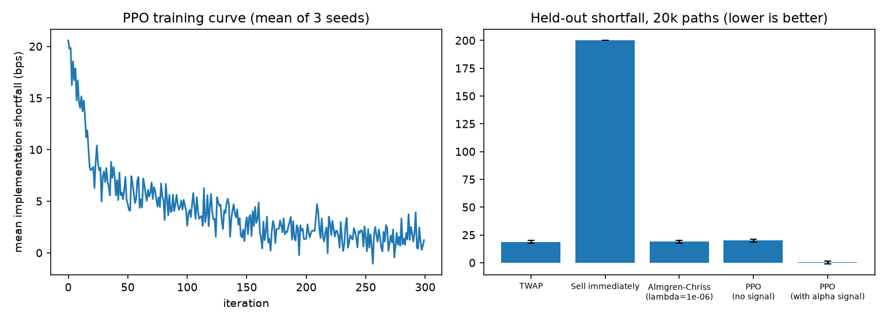

# exec-rl

> **A from-scratch PPO agent that learns to beat TWAP and Almgren-Chriss at trade execution (simulation only).**

[](https://github.com/shaikn6/exec-rl/actions/workflows/ci.yml)
[](LICENSE)
[](requirements.txt)

**Optimal trade execution with reinforcement learning: a from-scratch PPO agent (PyTorch) that liquidates a
100,000-share position over 20 steps, benchmarked against TWAP and the Almgren-Chriss schedule on held-out
simulated paths.**

Simulation only: the market model and its alpha signal are synthetic, so the results show what the agent learns
under impact costs, not live-market performance (see [Limitations](#limitations)). To reproduce, see [Quickstart](#quickstart).

## Setup

Market model: Almgren-Chriss linear permanent and temporary impact, per-step Gaussian price noise, plus an
AR(1) **alpha signal** that predicts the next price drift. The agent chooses what fraction of remaining
inventory to sell each step; the reward is the negative implementation shortfall in basis points of arrival
notional.

Two engineering choices that matter:

- **Policy anchored on TWAP.** The network outputs a logit offset from the TWAP slice, so an untrained policy
  equals TWAP and learning only has to find improvements.
- **Low-variance reward.** The shortfall is rewritten by summation by parts so each step's reward carries only
  that step's price noise. The total is identical (a unit test checks it against the closed form). In an
  earlier experiment whose code and results are not kept in this repository, a naive reward that carries the
  accumulated price history did not learn: PPO finished at 30-38 bps, *worse* than TWAP.

## Results (20,000 held-out paths, 3 training seeds)

| Policy | Mean shortfall (bps) | Std |
|---|---|---|
| Sell immediately | 200.0 | 0 |
| TWAP | 18.8 | 83.7 |
| Almgren-Chriss (best risk-aversion on grid) | 18.8 | 80.8 |
| PPO, signal hidden (ablation) | 19.86 | 99.3 |
| **PPO, with alpha signal** | **0.22** (mean of seeds 0.01 / 0.00 / 0.64; across-seed std 0.37) | 83.5 |

The PPO rows are the mean over the 3 seeds; Std is the per-path shortfall std averaged over seeds, and the
across-seed std is the spread of the 3 seed means. Paired difference vs TWAP (seed-averaged cost per path): -18.5 bps (SE 0.18). Without the
signal, PPO is no better than TWAP and Almgren-Chriss (slightly worse), which is the expected result when there is nothing to exploit. At
this signal strength (drift 0.12), a tuned linear signal rule reaches ~3.5 bps (`study.json`), so the learned policy beats the
linear rule, but a two-parameter time-varying rule reaches ~-1.8 bps (`study_extra.json`) and beats PPO.



## Limitations

- **Simulation only.** The market model and its alpha signal are synthetic. The numbers show what the agent
  learns under Almgren-Chriss impact costs with a predictive-by-construction signal; they are not a claim about
  live-market performance (real microstructure, latency, adverse selection and transaction costs are absent).
- **The edge is the signal, not the agent.** Without the alpha signal PPO is no better than TWAP or
  Almgren-Chriss (the ablation row is slightly worse) -- the expected null result when there is nothing to
  exploit.
- **A tuned rule can beat PPO.** At a strong signal a two-parameter time-varying linear rule tuned on training
  paths beats every PPO seed (`study_extra.json`); the learned policy is not the best achievable policy here.
- **Seed reporting.** The PPO row is the mean over 3 seeds. An earlier version reported the best seed, which is
  selection on the evaluation paths; `study.py` sweeps signal strength and impact against a tuned linear rule.

## Optimal reference

The environment is linear-quadratic, so `execrl/lq.py` computes the exact risk-neutral optimum (ignoring the
no-buyback constraint) by a backward Riccati recursion, and `execrl/dp.py` solves the constrained problem by grid
dynamic programming. `study_extra.py` (writes `study_extra.json`) measures every policy's gap to the constrained
optimum and adds risk, policy-surface, signal-persistence, richer-rule, training-curve and exploration experiments.
In this simulation a two-parameter time-varying signal rule tuned on training paths beats every PPO seed wherever
there is a signal.

`study_clone.py` (writes `study_clone.json`, about 25 minutes) asks whether that gap is a limit of the network or of
training. It fits the same network to the optimum's decisions by regression, then continues PPO from the fitted
network. In this simulation the fitted network is within 0.01 bps of the optimum, and PPO started from it removes
83% to 89% of the from-scratch gap but still drifts 0.3 to 3.8 bps away.

`study_nonlinear.py` (writes `study_nonlinear.json`, 5 seeds) asks whether RL helps once impact is non-linear, so no
closed-form optimum exists. It switches to square-root impact (per-step cost proportional to shares sold to the power
1.5) and uses the grid dynamic-programming optimum as the benchmark. PPO still trails the tuned linear rule: at drift
0.12 its mean is 5.6 bps above the optimum against 4.6 for the linear rule, and at drift 0.24 it is 32.8 against 14.6.
The quadratic-impact control reproduces the main study's TWAP, linear-rule and optimum values.

## Quickstart

```bash
pip install -r requirements.txt   # Python 3.12+, pinned versions (see below)
python -m execrl.evaluate   # fast check (~1s): reprints the baseline rows, no training, no file writes
python run.py             # trains 6 agents (~3 min on a laptop CPU), writes results.json and results.png
python study.py           # signal/impact sweeps and long training -> study.json
python study_extra.py     # optimum and follow-up experiments -> study_extra.json
python study_clone.py     # network-capacity vs training check (~25 min) -> study_clone.json
python study_nonlinear.py # square-root impact against the grid optimum -> study_nonlinear.json
python -m pytest           # 23 tests
```

`python -m execrl.evaluate` is the fast reproduce: it scores the three schedule baselines on the 20,000
held-out paths and prints `TWAP 18.763`, `Almgren-Chriss 18.831` and `Sell immediately 200.000` bps, matching
the baseline rows of `results.json` without retraining. `python run.py` reproduces the full table including the
PPO agents.

`pip install -r requirements.txt` (Python 3.12+) installs the exact versions (numpy, torch, matplotlib, pytest and their
dependencies) with which a fresh Python 3.12 venv on macOS arm64 reproduced `results.json` and `results.png`
bit-for-bit; other platforms or BLAS builds may differ in the last digits. `requirements-ranges.txt` has the looser
version ranges for other Python versions.

## License

MIT

---
<sub>Part of [Nagizaaz Shaik's open-source work](https://github.com/shaikn6) · [all repositories](https://github.com/shaikn6?tab=repositories)</sub>
