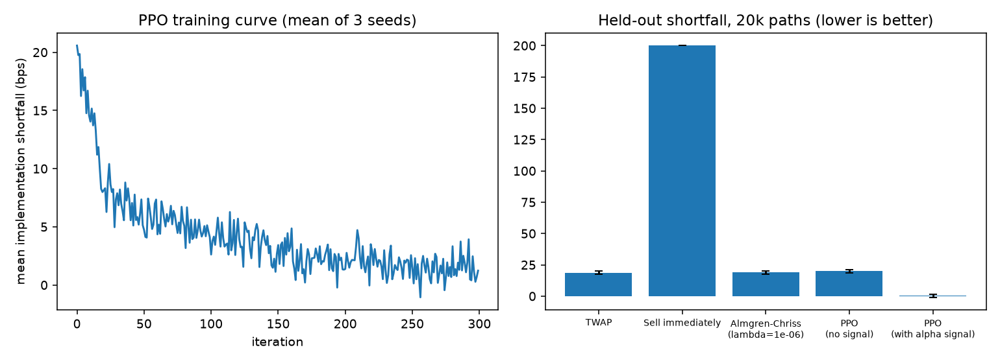

# exec-rl

Optimal trade execution with reinforcement learning: a from-scratch PPO agent (PyTorch) that liquidates a
100,000-share position over 20 steps, benchmarked against TWAP and the Almgren-Chriss schedule on held-out
simulated paths.

## Setup

Market model: Almgren-Chriss linear permanent and temporary impact, per-step Gaussian price noise, plus an
AR(1) **alpha signal** that predicts the next price drift. The agent chooses what fraction of remaining
inventory to sell each step; the reward is the negative implementation shortfall in basis points of arrival
notional.

Two engineering choices that matter:

- **Policy anchored on TWAP.** The network outputs a logit offset from the TWAP slice, so an untrained policy
  equals TWAP and learning only has to find improvements.
- **Low-variance reward.** The shortfall is rewritten by summation by parts so each step's reward carries only
  that step's price noise. The total is identical (a unit test checks it against the closed form), but
  a naive reward that carries the accumulated price history did not learn: PPO finished at 30-38 bps, *worse*
  than TWAP.

## Results (20,000 held-out paths, 3 training seeds)

| Policy | Mean shortfall (bps) | Std |
|---|---|---|
| Sell immediately | 200.0 | 0 |
| TWAP | 18.8 | 83.7 |
| Almgren-Chriss (best risk-aversion on grid) | 18.8 | 80.8 |
| PPO, signal hidden (ablation) | 19.86 | 99.3 |
| **PPO, with alpha signal** | **0.22** (mean of seeds 0.01 / 0.00 / 0.64; across-seed std 0.37) | 83.5 |

The PPO rows are the mean over the 3 seeds; Std is the per-path shortfall std averaged over seeds, and the
across-seed std is the spread of the 3 seed means. Paired difference vs TWAP (seed-averaged cost per path): -18.5 bps (SE 0.18). Without the
signal, PPO is no better than TWAP and Almgren-Chriss (slightly worse), which is the expected result when there is nothing to exploit. At
this signal strength (drift 0.12), a tuned linear signal rule reaches ~3.5 bps (`study.json`), so the learned policy beats the
linear rule, but a two-parameter time-varying rule reaches ~-1.8 bps (`study_extra.json`) and beats PPO.



## Caveats

The market is simulated and the signal is predictive by construction, so these numbers show the agent learns to
use an alpha signal under impact costs. They are not a claim about live-market performance. The PPO row is the
mean over 3 seeds (an earlier version reported the best seed, chosen on the evaluation paths). `study.py`
sweeps signal strength and impact against a tuned linear signal rule; with a strong signal the simple rule beats PPO.

## Optimal reference

The environment is linear-quadratic, so `execrl/lq.py` computes the exact risk-neutral optimum (ignoring the
no-buyback constraint) by a backward Riccati recursion, and `execrl/dp.py` solves the constrained problem by grid
dynamic programming. `study_extra.py` (writes `study_extra.json`) measures every policy's gap to the constrained
optimum and adds risk, policy-surface, signal-persistence, richer-rule, training-curve and exploration experiments.
In this simulation a two-parameter time-varying signal rule tuned on training paths beats every PPO seed wherever
there is a signal.

`study_clone.py` (writes `study_clone.json`, about 25 minutes) asks whether that gap is a limit of the network or of
training. It fits the same network to the optimum's decisions by regression, then continues PPO from the fitted
network. In this simulation the fitted network is within 0.01 bps of the optimum, and PPO started from it removes
83% to 89% of the from-scratch gap but still drifts 0.3 to 3.8 bps away.

## Run

```bash
python run.py            # trains 6 agents (~3 min on a laptop CPU), writes results.json and results.png
python study.py           # signal/impact sweeps and long training -> study.json
python study_extra.py     # optimum and follow-up experiments -> study_extra.json
python -m pytest tests     # 13 tests
```

Requires Python 3.10+; `pip install -r requirements.txt` (numpy, torch, matplotlib, pytest).

## License

MIT
